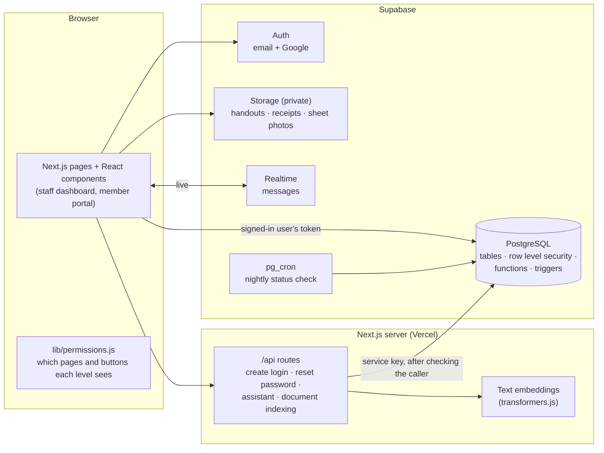
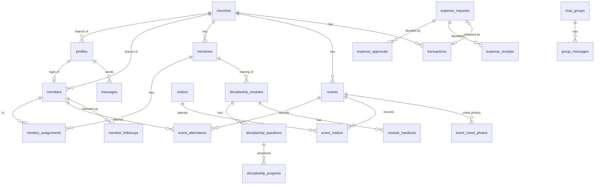

# FaithSync — System Documentation

How FaithSync is built: its parts, its database, what each user level can do, and how the data is protected. For installation, see [DEPLOYMENT.md](DEPLOYMENT.md).

## 1. Overview

FaithSync is a web application for **God's Grace Christian Fellowship Global Ministries Inc.** and its branches. It serves six user levels from one code base: church staff use the **staff dashboard**, members use the **member portal**. Every branch's data is kept apart; the Pastor and the Admin see across branches.

## 2. Architecture

**Layers**

| Layer | Where | Role |
|---|---|---|
| Pages | `src/app/dashboard/*`, `src/app/member-dashboard/*`, `src/app/(auth)/*` | Screens for each feature; the layout checks `canOpenPage()` before showing a page |
| Shared components | `src/app/components/*` | Attendance sheet, spending requests, messenger, date / time pickers, dialogs, reminders, person profile, app shell |
| Helpers | `src/app/lib/*` | `permissions.js` (levels and features), Supabase clients, Philippine dates, event series, the assistant's language and search helpers |
| Server routes | `src/app/api/*` | Actions that need the secret service key. Each route first checks the caller's session and level (`lib/apiAuth.ts`) |
| Database | `db/000 … 067` | Tables, **row level security**, functions for multi-step actions (approvals, attendance, follow-up), triggers (activity log, locks, automatic stamps), the nightly job |

**Two layers of permission.** `permissions.js` decides what each level **sees** (menu, pages, buttons). The database decides what each level can **actually read and change**, on every table, whatever screen or tool is used. The screens could be bypassed; the data rules cannot.

## 3. Database

PostgreSQL on Supabase. Every change is a numbered file in `db/` (run in order; each has a header explaining why, and a check query). `db/000` records the tables first made by hand in the Supabase dashboard.

### Main tables and how they connect

| Group | Tables |
|---|---|
| People | `churches`, `profiles` (logins), `members`, `ministries`, `ministry_assignments`, `attendance_helpers` |
| Events and attendance | `events`, `event_attendance`, `visitors`, `event_visitors`, `event_sheet_photos` |
| Follow-up | `member_followups` |
| Finance | `transactions`, `finance_settings`, `expense_requests`, `expense_approvals`, `expense_receipts` |
| Training | `discipleship_modules`, `discipleship_questions`, `discipleship_progress`, `module_handouts`, `module_views` |
| Communication | `announcements`, `messages`, `chat_groups`, `chat_group_members`, `group_messages` |
| Assistant | `chatbot_documents`, `knowledge_chunks`, `assistant_chats`, `assistant_messages`, `assistant_usage` |
| Personal and system | `devotional_journal`, `bible_verses`, `activity_log`, `page_visits` |

**Views** give limited columns to people who may not read a whole table: `member_directory` (names, ministries), `member_names` (names only, for the Admin), `chat_contacts` (who you can message).

**Design choices**
- **Never deleted, only closed:** members are *archived*, finance entries *voided*, events *cancelled* — the record stays traceable.
- **Some names are stored as text on purpose:** the payee on a transaction (can be a store, not a member), and the requester / approver names on spending requests (Finance can't read logins, but must see who asked).
- **Dates follow the Philippines:** `ph_today()` and `Asia/Manila` everywhere a "today" matters.

## 4. User levels and what each can do

| Feature | Admin | Pastor | Leader | Finance | Secretary | Member |
|---|---|---|---|---|---|---|
| Users (levels, branches, Elders, disable, reset password) | **Manage** | — | — | — | — | — |
| Members | names only | **Add, edit, archive** (all branches) | View | names in Finance | **Add, edit, import, logins, archive** | own |
| Follow-up | — | Manage (all) | Log follow-ups | — | Manage | — |
| Events | View | View; approve where a branch has no Leader | **Add, approve, cancel** | View | Add (for approval) | View approved |
| Attendance | View | Take (all) | Take | View | Take | Own; helpers take |
| Finance ledger | — | View (all) | View | **Record, void** | — | — |
| Spending requests | — | Request, approve, set limits | Request, approve (Elders: large, love gifts) | Release, check receipts | — | — |
| Ministries | View | **Manage** | Members of the ministry they head | — | View | Own |
| Training | View | Manage, review | Manage (general + own ministry), review | — | — | Take |
| Announcements | View | Post (all branches) | Post (own branch) | View | View | View |
| Bible verses | View | Add, **delete** | Add | — | — | Verse of the day |
| Assistant | Ask | Ask, documents | Ask, documents | Ask | Ask | Ask (daily limit) |
| Activity | Change log, screen time | Screen time | — | — | — | — |
| Messages, journal, profile | ✓ | ✓ | ✓ | ✓ | ✓ | ✓ |

Branch scope: the **Admin and Pastor** see all branches (with a branch picker); everyone else only their own. An **attendance helper** is a Member the Pastor or Secretary allows to take attendance. An **Elder** is a Leader the Admin marks as Elder.

## 5. Security

| Area | How it's handled |
|---|---|
| **Authorization** | Row level security on every table; 150+ rules scoped by level and branch (`get_my_role()`, `get_my_church_id()`). Multi-step actions run in database functions that check the caller first (e.g. `pastor_review_events`, `set_attendance`). Triggers block what rules can't express (voided entries locked, released-request entries locked, only the Admin changes levels). |
| **Authentication** | Supabase Auth: hashed passwords, email or Google sign-in, a temporary password that must be changed on first sign-in, logins the Admin can disable (a disabled login loses all access at once), archiving a member switches off their member login. |
| **Input** | All database access goes through Supabase's API with parameters (no SQL is built from text), so SQL injection isn't possible. The database checks values itself (allowed statuses, amounts above zero, lengths). React escapes all text it shows; no raw HTML is inserted. |
| **Server routes** | Need the signed-in user's token (so they can't be triggered from another site), check the caller's level, and read data as the caller so the database rules still apply. The service key never reaches the browser. |
| **Files** | Private storage buckets; files open through links that expire. Who may upload, open or delete follows the same rules as the record (e.g. receipts: the requester and Finance of that branch). |
| **Privacy** | Members never see other members' status or phone numbers; the Admin sees member names only; visitors and sign-in sheet photos are deleted 6 months after the last visit / the event; the activity log hides member phone, email and birthday values. |
| **Error messages** | `lib/errors.js` turns database and server errors into plain sentences ("You don't have permission to do this.", "This already exists."); table, column and rule names never reach the screen. The technical detail goes to the browser console or the server log. Reasons written for users by FaithSync's own database functions are shown as they are. |
| **Audit** | `activity_log` records who added, changed, archived, voided or deleted what, and when (finance hidden from the Admin). |

**Known gaps** (planned): security headers (CSP, frame blocking, HSTS), automatic logout after inactivity, two-step login for staff, and three early read rules that also let signed-out visitors read Bible verses and training module titles / questions.

## 6. Automatic work

| What | When | Where |
|---|---|---|
| Active → Inactive after 14 days unseen, and back when seen | Nightly, 1 AM (Philippine time) | `pg_cron` job → `auto_member_status()` (db/056) |
| Approved events past their date become Done | When event pages load | `complete_past_events()` (db/042) |
| Visitors 6 months after their last visit are deleted | When attendance / visitor lists load | `purge_old_visitors()` (db/041) |
| Sign-in sheet photos older than 6 months are deleted | When the Attendance page loads | `purge_old_sheet_photos()` (db/060) |
| Released request → expense in the ledger; accepted receipts with change → income | When Finance acts | trigger `guard_expense_request` (db/019, 053) |

## 7. Outside services

| Service | Used for | If it is down |
|---|---|---|
| **Supabase** | Database, logins, files, live chat, nightly job | The app can't load data |
| **Google** | Optional sign-in / account linking | Email sign-in still works |
| **Hugging Face** (model download, first run only) | The assistant's text model | Only the assistant's meaning-based search is affected; keyword search still answers |
| **Vercel** | Hosting | Site offline |

The assistant uses **no outside AI service**: it understands the question itself (English and Tagalog, with spelling correction), searches the church's documents and handouts (keywords + meaning + typo-tolerant), and answers with the matching passages and their source.
